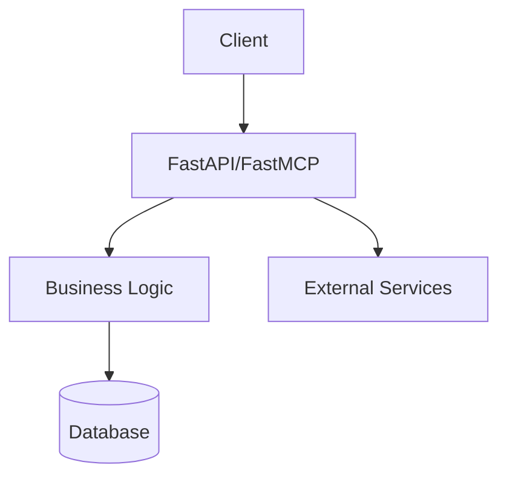

# Python App Setup Skill

This skill defines the preferred setup for Python applications in this workspace.

## When to Use This Skill

Use this skill when:
- Creating a new Python application
- Scaffolding a Python project
- Setting up a new FastAPI or FastMCP project
- Initializing a Python project from scratch

## Required Project Structure

All Python apps must include the following files and structure:

```
project/
├── Dockerfile
├── pyproject.toml
├── pytest.ini
├── openapi.yaml
├── README.md
├── INSTALL.md
├── SYSTEM.md
├── app/
│   ├── __init__.py
│   └── main.py
└── tests/
    ├── __init__.py
    └── test_main.py
```

## Requirements

### 1. Testing with pytest
- Use `pytest` as the testing framework
- Configure `pytest.ini` with appropriate settings
- All tests must be in a `tests/` directory
- Test files must follow `test_*.py` naming convention
- Include conftest.py if shared fixtures are needed

### 2. Docker Support
- Always include a `Dockerfile`
- Use Python 3.11+ as base image
- Use multi-stage builds for production images
- Include healthcheck for the container
- Expose appropriate port (default: 8000)

### 3. Framework
- Use either **FastAPI** or **FastMCP** as the web framework
- FastMCP preferred for MCP (Model Context Protocol) servers
- FastAPI for traditional REST APIs

### 4. OpenAPI Specification
- Generate `openapi.yaml` file
- Must be valid OpenAPI 3.x spec
- Include endpoint documentation
- Expose at `/openapi.yaml` endpoint
- Enable Swagger UI at `/docs`

### 5. Required Documentation Files

#### README.md
- Project title and description
- Quick start instructions
- Prerequisites
- How to run the application
- API endpoints overview

#### INSTALL.md
- Detailed installation instructions
- Environment variables configuration
- Dependencies setup
- Database setup if applicable

#### SYSTEM.md
- Architecture diagram in MermaidJS format
- System components description
- Data flow
- External dependencies
- Deployment notes

Example mermaid architecture:


### 6. Python Virtual Environment
- Always use a virtual environment for local development
- Create the virtual environment using `python -m venv venv`
- Activate the virtual environment using `source venv/bin/activate` (or `venv\Scripts\activate` on Windows)

## Implementation Checklist

When creating a new Python app, ensure:

- [ ] Virtual environment created with `python -m venv venv`
- [ ] Dockerfile with proper Python base image
- [ ] pyproject.toml with all dependencies
- [ ] pytest.ini configured
- [ ] FastAPI or FastMCP app in app/main.py
- [ ] openapi.yaml generated
- [ ] README.md with quick start
- [ ] INSTALL.md with detailed setup
- [ ] SYSTEM.md with MermaidJS architecture
- [ ] tests/ directory with test files
- [ ] .dockerignore file
- [ ] Requirements/dependencies properly pinned

## Commands

After setup, the following should work:

```bash
# Setup virtual environment
python -m venv venv && source venv/bin/activate

# Run tests
pytest

# Run with Docker
docker build -t app .
docker run -p 8000:8000 app

# Generate OpenAPI spec
python -c "from app.main import app; print(app.openapi())"
```
